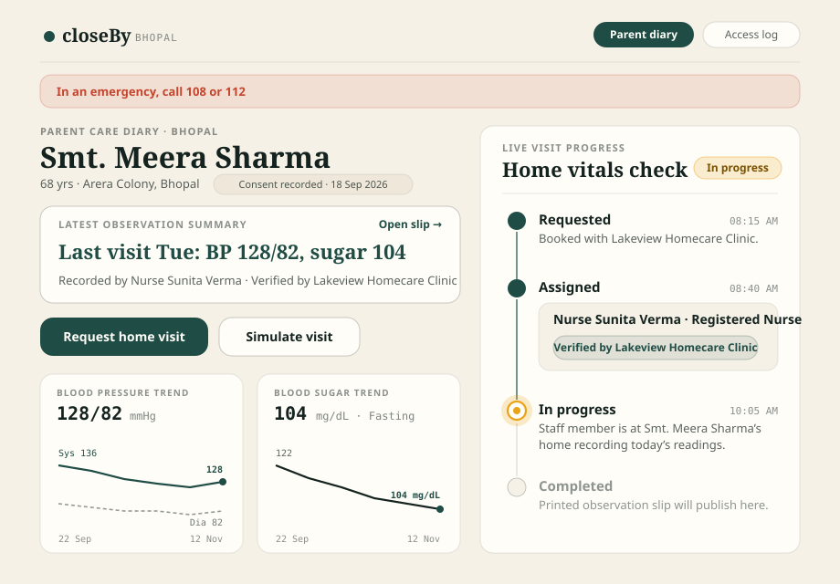
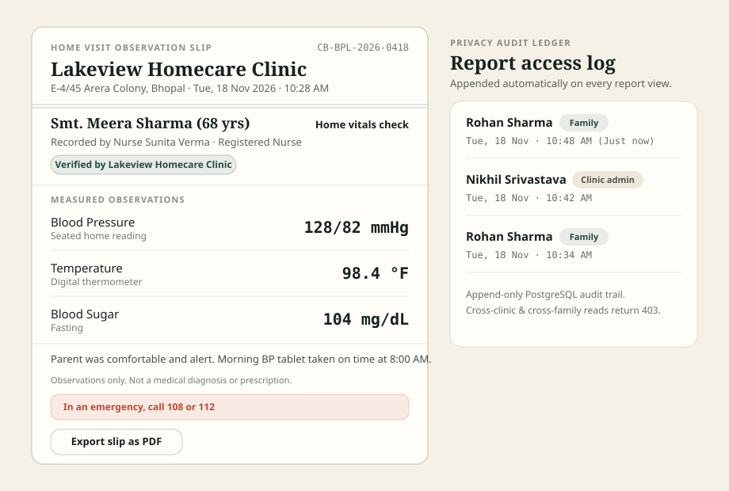
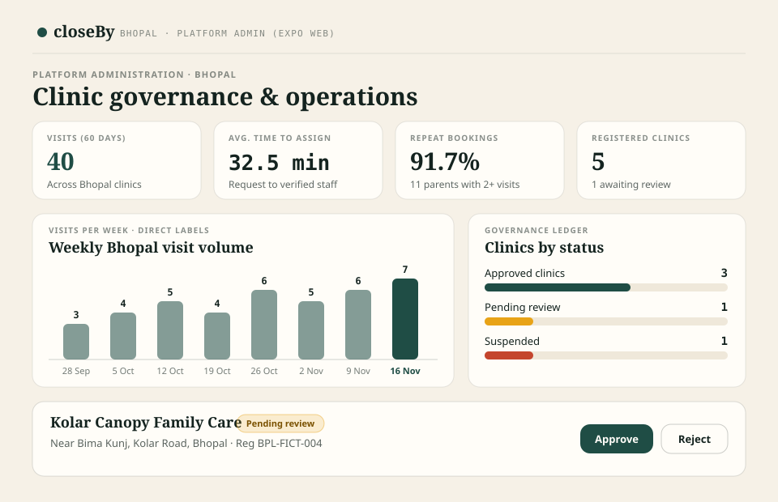
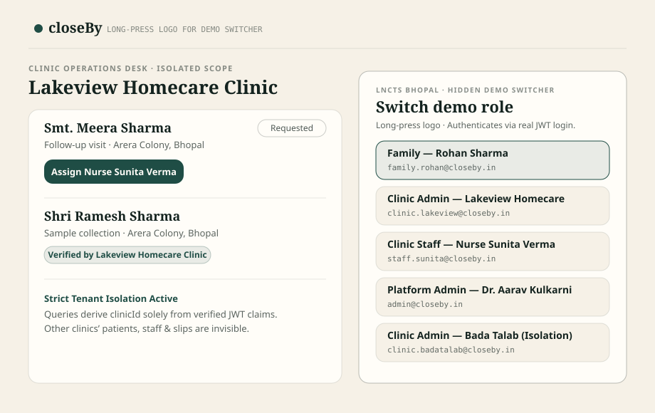
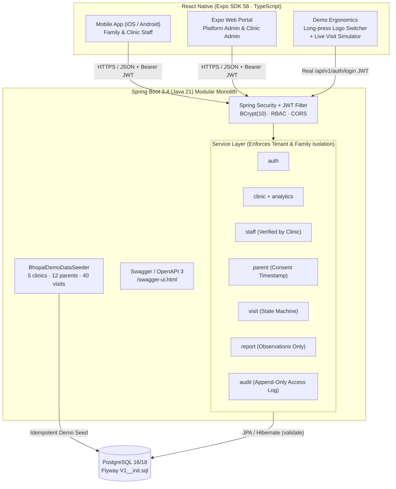
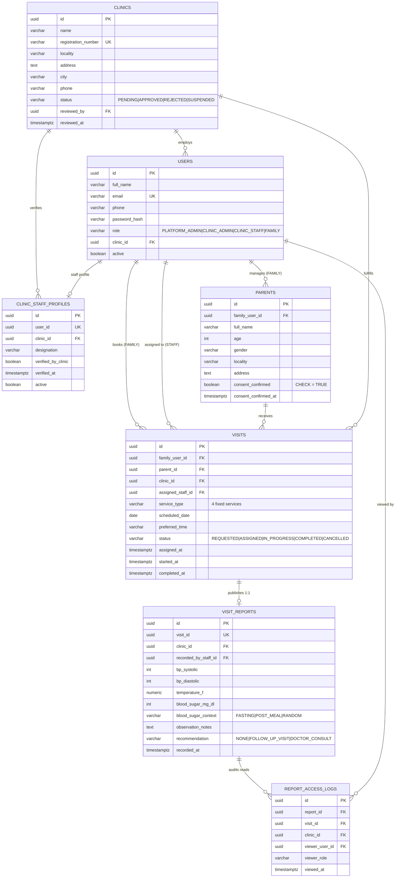

# closeBy — Remote Parent-Care Coordination Platform (Bhopal)

> **LNCTS Bhopal · Final-Year Major Project**  
> Built for live faculty evaluation — technically rigorous, strictly multi-tenant, and designed like a calm printed health diary.

**closeBy** helps families living away from their aging parents in Bhopal book home health visits through verified local clinics, follow visit progress live, and read factual observation slips afterwards. **The parent never needs the app or a smartphone.**

> **Clinical Boundary:** closeBy records factual home-visit observations only. It **never diagnoses** medical conditions and **never provides medical advice or prescriptions**. Key screens prominently display **"In an emergency, call 108 or 112"**.

---

## Screenshots

### 1. Family Home — Parent-First Diary, Trend Sparklines & Live 4-Stage Tracker


### 2. Printed Medical Observation Slip (with PDF Export) & Report Access Log


### 3. Platform Admin Dashboard (Expo Web) — Analytics & Clinic Governance


### 4. Clinic Operations Desk & Hidden Long-Press Demo Role Switcher


---

## System Architecture



---

## Entity-Relationship (ER) Diagram



---

## Core Capabilities & Safety Baseline

- **Four Roles & Strict RBAC:** `PLATFORM_ADMIN`, `CLINIC_ADMIN`, `CLINIC_STAFF`, and `FAMILY`.
- **Service-Layer Data Isolation:** Tenant (`clinicId`) and family (`userId`) scope are derived strictly from verified JWT claims inside the service layer—never trusted from client request bodies. Cross-clinic and cross-family reads return `403 Forbidden`.
- **Server-Side Visit State Machine:** Enforces `REQUESTED -> ASSIGNED -> IN_PROGRESS -> COMPLETED` (and `REQUESTED/ASSIGNED -> CANCELLED`). Illegal transitions return `409 Conflict`.
- **Timestamped Parent Consent:** Adding a parent rejects `consentConfirmed != true` and persists an immutable server UTC `consentConfirmedAt` timestamp.
- **Verified Staff Attribution:** Every staff member carries the **`Verified by <Clinic Name>`** mark across rosters, timelines, and slips.
- **Printed Medical Slip & PDF Export:** Observation-only reports display ruled lines, `IBM Plex Mono` readings, observations-only disclaimer, `108 or 112` emergency notice, and export cleanly to PDF (`expo-print` / `expo-sharing`).
- **Append-Only Report Access Log:** Every authorized `GET /api/v1/visits/{visitId}/report` automatically records `viewer_user_id`, `viewer_role`, and `viewed_at` in `report_access_logs`.
- **Editorial Visual System:** Warm paper `#F6F1E7`, ivory `#FFFDF8`, forest ink `#14231F`, deep forest teal `#1F4D45`, single focal marigold `#E8A317`, terracotta alert `#C4452D`, `Fraunces` + `DM Sans` (16px minimum body) + `IBM Plex Mono`, `lucide-react-native` (`1.75` stroke), `react-native-reanimated` transitions, and light haptics.

---

## Running Locally (Live Demo Setup)

### 1. Create PostgreSQL Database
```sql
CREATE DATABASE closeby;
```

### 2. Run Spring Boot Backend with Bhopal Demo Data
```powershell
cd backend
$env:DB_URL="jdbc:postgresql://localhost:5432/closeby"
$env:DB_USERNAME="postgres"
$env:DB_PASSWORD="your-postgres-password"
mvn spring-boot:run "-Dspring-boot.run.profiles=demo"
```
- API base URL: `http://localhost:8080/api/v1`
- Swagger / OpenAPI UI: `http://localhost:8080/swagger-ui.html`
- Seeder populates **5 fictional Bhopal clinics**, **6 verified staff**, **6 families**, **12 consented parents**, and **40 visits over the last 60 days** across all 5 statuses with realistic observation reports and access logs.

### 3. Run Expo App (Web & Mobile)
```powershell
cd mobile
npm install
npm run web      # Expo Web (recommended for Platform Admin & Clinic Admin + full demo)
# or
npm start        # Expo Go on Android / iOS
```
- **Hidden Demo Switcher:** Long-press the **`closeBy`** logo in the top header (`500ms`) on any screen to switch instantly between seeded roles via real JWT login.
- **Design System Specimen:** Open `/design-preview` (or tap *Design specimen* inside the Demo Switcher).

### Seeded Demo Accounts (Password: `Demo@1234`)

| Role | Name | Email | Scope |
| :--- | :--- | :--- | :--- |
| `FAMILY` | Rohan Sharma | `family.rohan@closeby.in` | Parents: Smt. Meera Sharma & Shri Ramesh Sharma (Arera Colony) |
| `CLINIC_ADMIN` | Nikhil Srivastava | `clinic.lakeview@closeby.in` | Lakeview Homecare Clinic (Approved · Arera Colony) |
| `CLINIC_STAFF` | Nurse Sunita Verma | `staff.sunita@closeby.in` | Verified by Lakeview Homecare Clinic |
| `PLATFORM_ADMIN` | Dr. Aarav Kulkarni | `admin@closeby.in` | Bhopal clinic governance & operational analytics |
| `CLINIC_ADMIN` | Meenakshi Dubey | `clinic.badatalab@closeby.in` | Bada Talab Care Collective (MP Nagar — Isolation Demo) |

---

## Automated Verification

- **Backend Integration Tests (`cd backend && mvn test`):** **5 tests, 0 failures**
  - `AuthAndClinicGovernanceIntegrationTest` — JWT auth, clinic `PENDING -> APPROVED -> SUSPENDED`, verified staff creation, Swagger `/v3/api-docs`.
  - `DataIsolationIntegrationTest` — Proves clinic isolation and family isolation at **both HTTP and Service layers**, plus parent consent validation.
  - `VisitLifecycleAndReportAuditIntegrationTest` — Proves every illegal status transition returns `409 Conflict` and every authorized report view increments `report_access_logs` (while unauthorized `403` attempts write 0 rows).
  - `BhopalDemoDataSeederIntegrationTest` — Verifies 5 fictional clinics, 12 consented parents, 40 visits across 60 days in all 5 statuses, idempotency, and Platform Admin analytics.
- **Frontend Type Check & Web Bundle (`cd mobile && npm run typecheck`):** **0 TypeScript errors**, full Expo Web export verified across all 23 route bundles.

---

## Documentation Index
- [PRD.md](PRD.md) — Product requirements, roles, lifecycle, and demo readiness
- [architecture.md](architecture.md) — Backend modules, schema, REST API, and folder layout
- [design.md](design.md) — Strict editorial art direction, tokens, hard bans, and microcopy
- [rules.md](rules.md) — Coding conventions, security rules, and AI operating rules
- [phases.md](phases.md) — 4-phase delivery plan and completion checklist
- [DEMO_SCRIPT.md](DEMO_SCRIPT.md) — Step-by-step 5-minute faculty presentation script
- [memory.md](memory.md) — Architectural & product decisions log
